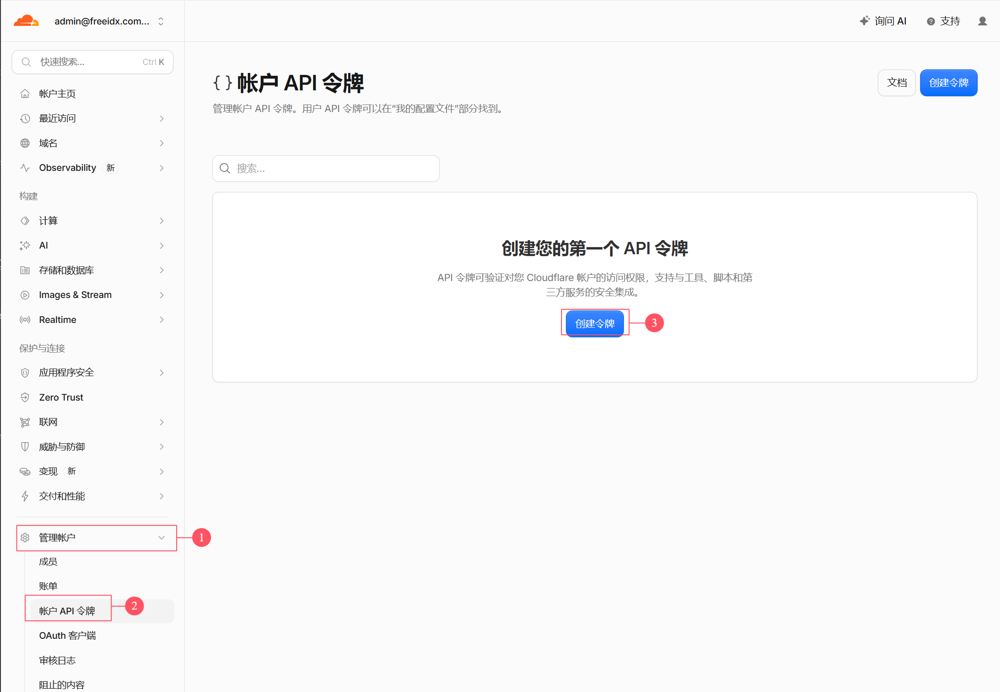

# FreeIDX

[English](../README.md) · **简体中文** · [繁體中文](README-zh-tw.md) · [日本語](README-ja.md) · [한국어](README-ko.md) · [Français](README-fr.md) · [Deutsch](README-de.md) · [Español](README-es.md) · [Русский](README-ru.md) · [ไทย](README-th.md)

**基于 Cloudflare 全栈打造的免费、开源现代论坛。**

`Cloudflare Workers` · `React 19` · `Tailwind CSS 4` · `Hono` · `TypeScript` · `D1` · `KV` · `R2` · `多语言` · `AGPL-3.0`

[功能亮点](#-功能亮点) · [架构设计](#️-架构设计) · [快速开始](#-快速开始) · [自定义域名](#-自定义域名) · [仓库结构](#-仓库结构)

***

一个基于 Cloudflare Workers + D1 + KV + R2 的论坛，支持帖子、评论、附件上传、会员体系、SEO 收录、多语言等。

**💡 全站免费运行**：前后端合并为一个 Worker 项目部署，静态资源走 Workers Assets，D1/KV/R2 全部使用免费层，零成本、零运维。

***

## 🏗️ 架构设计

### 单 Worker 合并部署方案

```
用户访问：forum.example.com
         ↓
   Cloudflare Worker「freeidx-api」（Edge 网络）
         ↓
  ┌─ Worker 判断路由
  │
  ├─ /assets/* ?
  │  └─ YES → Workers Assets 直接返回静态文件（不消耗 Worker 请求）
  │
  ├─ /api/* / /files/* ?
  │  ├─ YES → Hono Worker 处理业务逻辑
  │  │         ├ JWT + Session 双轨鉴权
  │  │         ├ 权限引擎（用户组 × 版块 × 版主）
  │  │         └ 返回 JSON / 流式代理 R2 文件
  │
  └─ 其他   → 爬虫预渲染 HTML / SPA index.html，React Router 接管
```

### 技术栈

| 层    | 选型                                                                               |
| ---- | -------------------------------------------------------------------------------- |
| 前端   | React 19 + React Router 7 + Tailwind CSS 4 + TanStack Query + Zustand + Vite     |
| 后端   | Hono + TypeScript + Zod（Cloudflare Workers）                                      |
| 数据库  | D1（SQLite），KV 做低频写缓存，Cache API 做边缘缓存                                             |
| 存储   | R2（附件/头像，Worker 流式代理 `/files/:key`）                                              |
| 鉴权   | JWT（httpOnly Cookie）+ D1 session 表，PBKDF2-SHA256                                 |
| 人机验证 | Cloudflare Turnstile                                                             |
| 计划任务 | Cron Triggers（每 5 分钟档 + 每小时对账档 + 每日凌晨档）                                          |
| 包管理  | pnpm workspace + Turborepo（monorepo：`apps/web` / `apps/api` / `packages/shared`） |

## ✨ 功能亮点

### 📝 论坛核心

- ✅ **帖子管理** - 发布、编辑、删除、置顶、关闭、移动版块、精华，光标分页 + 无限滚动， TanStack Query 乐观更新（发帖数、浏览量即时反馈）
- ✅ **评论系统** - 回帖、引用、关键词高亮、已读标记、多级回复
- ✅ **附件上传** - 图片/文件直传 R2，Worker 流式代理 `/files/:key`，享受零出站流量费并规避存储 B 类操作额度；内置 **TipTap 富文本编辑器**，支持代码插入、图片粘贴上传
- ✅ **搜索** - 版块内关键词检索，高亮命中片段

### 👥 用户与权限

- ✅ **用户认证** - 注册、登录、退出、邮件验证码、找回密码，JWT（httpOnly Cookie）+ Session 表双轨鉴权，CSRF 全站防护
- ✅ **三层权限体系** - 用户组 × 版块 access × 版主规则引擎，精细到单个版块的读写与版务授权
- ✅ **用户组自动升级** - 发帖数 + 主题数落入 credits 区间自动换组，无需人工干预
- ✅ **个人中心** - 头像上传、资料修改、密码修改、我的主题/回帖、邮件通知偏好
- ✅ **版务操作** - 置顶/关闭/删除/移动/删用户，支持批量处理

### 💎 会员与商业化

- ✅ **会员体系** - 积分 + 等级 + VIP + 付费附件 + 订单支付完整闭环
- ✅ **支付通道插件化** - card / paypal / stripe / alipay 每通道一个独立插件，payment-core 只含契约 + 注册表 + 订单状态机，后台逐个启停、换密钥零部署
- ✅ **广告系统** - 自定义广告位 + Google AdSense，多点位灵活配置

### 🔌 扩展与工程化

- ✅ **插件机制** - hook / overwrite 扩展点 + 前端组件插槽，后台热插拔，不改核心代码即可增强功能
- ✅ **管理后台** - 站点设置、版块、主题、用户、用户组、缓存一站式管理
- ✅ **多语言** - 中文简繁 / 英 / 日 / 韩 / 法 / 德 / 西 / 俄 / 泰 共 10 种语言，脚本化生成 + pre-commit 全链路校验，杜绝硬编码文案
- ✅ **计划任务** - Cron Triggers 三档调度（每 5 分钟 / 每小时对账 / 每日凌晨），session 回收、日统计清零、附件 GC、掉单对账全自动

### 🔍 SEO / GEO 收录

- ✅ **爬虫预渲染** - 写入期预生成 SEO HTML 存 R2 + Cache API，仅爬虫 UA 读取，请求期渲染 CPU 结构性归零
- ✅ **收录全家桶** - sitemap、JSON-LD 结构化数据、llms.txt、AI 爬虫策略、robots，`.htm` 伪静态 URL 保持兼容
- ✅ **边缘缓存** - Cache API 读取屏障，热门接口第二跳 `x-edge-cache: HIT`，大幅节省 D1 读取额度

### 🔐 安全与免费层适配

- ✅ **密码安全** - PBKDF2-SHA256（WebCrypto），迭代数针对 Workers 10ms CPU 上限调优，兼容旧哈希懒升级
- ✅ **人机验证** - 集成 Cloudflare Turnstile，登录/注册/发帖/回帖/找回密码全挂载
- ✅ **邮件服务** - SMTP / Email Provider 账号池，验证邮件、找回密码稳定送达
- ✅ **免费层深度适配** - 多层缓存（Isolate 内存 LRU + KV + D1 cache 表 + Cache API）、`DB.batch()` 合并查询、`waitUntil` 异步合并计数，把 10 万请求/天、500 万行读/10 万行写的额度用到极致

## 🚀 快速开始

## 方法 1：GitHub Actions 自动部署（推荐）

项目已内置 `.github/workflows/deploy.yml`，推送到 `main` 分支或手动触发时自动构建并部署到 Cloudflare。D1 / KV 由流水线**按名字自动查找、缺了自动创建**，无需手动编辑任何仓库文件。

#### 第一步：获取 Cloudflare API Token

1. 登录 [Cloudflare Dashboard](https://dash.cloudflare.com/)
2. 进入 **My Profile > API Tokens**，点击 **Create Token**

   
3. 点击“查看所有模板”，在模板卡片页选择 **Developer Services** 模板，其余不用设置，点 **审核令牌** 就完成了。
4. 复制 Token（只会显示一次），并到账户页复制 Account ID，两者一并保存好。

#### 第二步：配置 GitHub Secrets

项目fork到你自己的仓库中，在你的 GitHub 仓库中：

1. 进入 **Settings > Secrets and variables > Actions**
2. 添加以下密钥，对照下图找入口：

   ① **Settings** → ② **Secrets and variables → Actions** → ③ **Secrets** 标签页 → ④ **New repository secret**。

   

| Secret 名称               | 值                        | 描述           | 是否必需 |
| ----------------------- | ------------------------ | ------------ | ---- |
| `CLOUDFLARE_API_TOKEN`  | Cloudflare API Token     | 第一步创建的 Token | 必需   |
| `CLOUDFLARE_ACCOUNT_ID` | 你的 Cloudflare Account ID | 账号首页右侧栏      | 必需   |

**Variables：**

| Variable 名称         | 值                             | 描述                                                                                                      | 是否必需 |
| ------------------- | ----------------------------- | ------------------------------------------------------------------------------------------------------- | ---- |
| `SITE_URL`          | 站点 URL                        | 例如：`https://forum.example.com`（还没域名就**先不要创建这个变量**，绑域后回来补；不要填"留空"二字）                                     | 非必需  |
| `TURNSTILE_SITEKEY` | Cloudflare Turnstile Site Key | [Cloudflare Turnstile](https://dash.cloudflare.com/?to=/:account/turnstile)；不创建则前端不渲染验证组件。改值必须重新部署前端才生效 | 非必需  |

### 第三步：首次部署

在 GitHub 仓库的 **Actions** 页面：

1. 选择 **Deploy to Cloudflare** workflow
2. 点击 **Run workflow**，选择 `main` 分支，勾选 `run_seed` —— 初始版块 + 首个管理员（建表迁移会自动应用，无需勾选）。
3. 跑绿即上线，Worker `freeidx-api` 也是在这一步才被创建出来。**以后推 main 时 `run_seed` 默认关闭**，迁移会自动补齐且不会改动既有业务数据。

#### 第四步：配置运行时密钥

首次部署跑绿后，Workers 列表里才会出现 `freeidx-api`。点进去 → **Settings → Variables and secrets（添加环境变量）**，类型选 **Secret（**密钥**）**，逐个添加（保存后不可见，但不会被部署覆盖，填一次长期有效）：

| 名称                   | 用途                                     | 是否必需         |
| -------------------- | -------------------------------------- | ------------ |
| `JWT_SECRET`         | 登录令牌 / CSRF 签名                         | 必需           |
| `TURNSTILE_SECRET`   | 人机验证服务端校验（需与 `TURNSTILE_SITEKEY` 成对配置） | 非必需          |
| `SECRETS_MASTER_KEY` | 插件支付密钥的 AES-GCM 主密钥                    | 非必需          |

随机值本地生成一条粘一条：

```bash
node -e "console.log(require('crypto').randomBytes(32).toString('hex'))"
```

### 方法 2：本地开发

```bash
pnpm install

# 先构建前端，再起后端（wrangler dev 读同一份 [assets] 配置）
pnpm --filter @freeidx/web build
pnpm --filter @freeidx/api dev
```

- 本地跑 miniflare，不需要真实资源 ID
- 密钥放 `apps/api/.dev.vars`
- 数据库：`pnpm db:apply` 应用迁移，`pnpm db:seed` 灌入初始数据

## 方法 3：Cloudflare 后台可视化构建

Workers & Pages → Create → **Continue with GitHub** 也能部署，但要求在 GitHub 网页手工把 D1/KV 的真实 ID 和 `SITE_URL` 填进 `apps/api/wrangler.toml`（仓库里是占位值，不改必失败），且项目名必须是 `freeidx-api`。与流水线二选一。

## 🌐 自定义域名配置

1. Cloudflare 首页 → **Add a domain**，把域名托管进来，去注册商改两条 NS
2. Workers → `freeidx-api` → **Settings → Domains & Routes → Add → Custom domain**
3. 回到 GitHub Variables 把 `SITE_URL` 填成这个域名，随便推一次提交让它生效

不需要配 Route，`/api/*`、`/files/*` 和页面路径都在同一个 Worker 里。绑好自定义域后边缘缓存自动生效，顺手关掉 `*.workers.dev` 预览域，避免被搜索引擎当成重复内容收录。

**默认管理员账号**（首次登录后请立即修改！）：

- 邮箱: `admin@admin.com` / 密码: `1`

## 📦 仓库结构

```
FreeIDX/
├── apps/
│   ├── web/               # 前端 React 19 SPA → Worker Static Assets
│   └── api/               # 后端 Hono Worker（含 migrations/）
├── packages/
│   └── shared/            # 前后端共享类型、错误码、i18n 资源
├── scripts/               # i18n 生成与校验脚本
├── docs/                  # 设计文档（开发架构 / 前后端页面设计 / 部署手册）
└── .github/workflows/     # CI / 部署流水线
```

## 📄 许可证

本项目基于 [GNU Affero 通用公共许可证 v3.0（AGPL-3.0）](../LICENSE) 开源。

**重要提示：** 依据 AGPL-3.0 第 13 条，任何人修改本项目代码并对外通过网络提供服务（SaaS）时，**必须**向该服务的使用者公开修改后的完整源代码。

## 🙋 支持

- 💬 欢迎提交 Issue 和 Pull Request
- 🌟 如果有帮助，请 Star 本项目！

