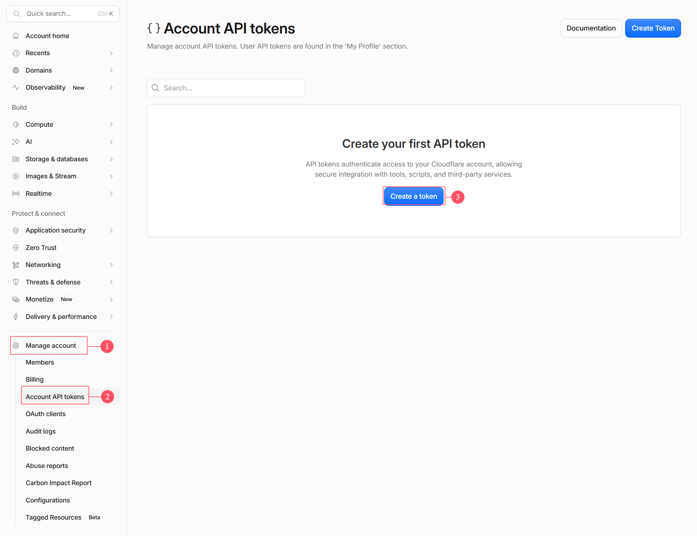
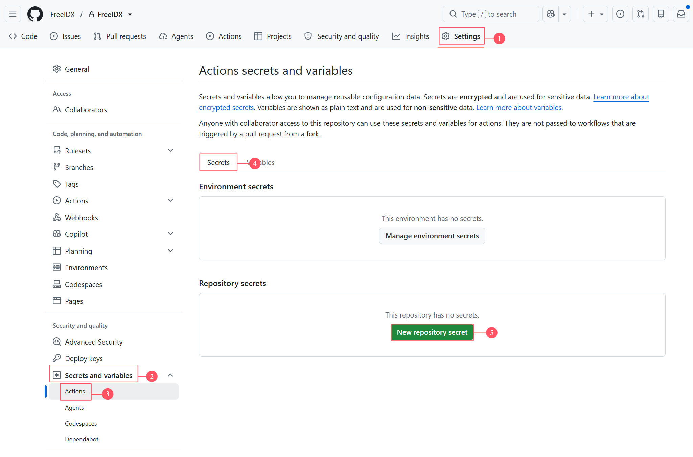

# FreeIDX

[English](../README.md) · [简体中文](README-cn.md) · [繁體中文](README-zh-tw.md) · [日本語](README-ja.md) · [한국어](README-ko.md) · [Français](README-fr.md) · **Deutsch** · [Español](README-es.md) · [Русский](README-ru.md) · [ไทย](README-th.md)

**Ein kostenloses, quelloffenes, modernes Forum – vollständig auf Cloudflare aufgebaut.**

`Cloudflare Workers` · `React 19` · `Tailwind CSS 4` · `Hono` · `TypeScript` · `D1` · `KV` · `R2` · `i18n` · `AGPL-3.0`

[Funktionen](#-funktionen) · [Architektur](#️-architektur) · [Schnellstart](#-schnellstart) · [Custom Domain](#-custom-domain-einrichten) · [Repository-Struktur](#-repository-struktur)

***

Ein Forum auf Basis von Cloudflare Workers + D1 + KV + R2 mit Unterstützung für Beiträge, Kommentare, Attachment-Uploads, Mitgliedschaft, SEO-Indexierung, Mehrsprachigkeit und mehr.

**💡 Läuft vollständig kostenlos**: Frontend und Backend werden als ein einziges Worker-Projekt deployed, statische Assets werden über Workers Assets ausgeliefert, und D1/KV/R2 bleiben durchweg im Free Tier – keine Kosten, kein Betriebsaufwand.

***

## 🏗️ Architektur

### Kombiniertes Deployment in einem einzelnen Worker

```
User visits: forum.example.com
         ↓
   Cloudflare Worker「freeidx-api」(Edge network)
         ↓
  ┌─ Worker route matching
  │
  ├─ /assets/* ?
  │  └─ YES → Workers Assets serves static files directly (no Worker request consumed)
  │
  ├─ /api/* / /files/* ?
  │  ├─ YES → Hono Worker handles business logic
  │  │         ├ JWT + Session dual-track authentication
  │  │         ├ Permission engine (user groups × sections × moderators)
  │  │         └ Returns JSON / streams R2 files via proxy
  │
  └─ Others → Crawler pre-rendered HTML / SPA index.html, handled by React Router
```

### Tech-Stack

| Ebene             | Auswahl                                                                               |
| ----------------- | ------------------------------------------------------------------------------------- |
| Frontend          | React 19 + React Router 7 + Tailwind CSS 4 + TanStack Query + Zustand + Vite          |
| Backend           | Hono + TypeScript + Zod (Cloudflare Workers)                                          |
| Datenbank         | D1 (SQLite), KV für Caching mit niedriger Schreibfrequenz, Cache API für Edge-Caching |
| Storage           | R2 (Anhänge/Avatare, gestreamt über den Worker-Proxy `/files/:key`)                   |
| Auth              | JWT (httpOnly Cookie) + D1-Session-Tabelle, PBKDF2-SHA256                             |
| CAPTCHA           | Cloudflare Turnstile                                                                  |
| Geplante Aufgaben | Cron Triggers (5-Minuten-Ebene + stündliche Abgleich-Ebene + tägliche Ebene)          |
| Paketverwaltung   | pnpm workspace + Turborepo (monorepo: `apps/web` / `apps/api` / `packages/shared`)    |

## ✨ Funktionen

### 📝 Forum-Kern

- ✅ **Beitragsverwaltung** - Veröffentlichen, Bearbeiten, Löschen, Anpinnen, Schließen, Verschieben zwischen Bereichen, Hervorheben; cursor-basierte Paginierung + Infinite Scrolling; optimistische Updates über TanStack Query (Beitrags- und Aufrufzahlen sofort sichtbar)
- ✅ **Kommentarsystem** - Antworten, Zitate, Keyword-Hervorhebung, Gelesen-Markierungen, mehrstufige Antworten
- ✅ **Attachment-Uploads** - Bilder/Dateien werden direkt zu R2 hochgeladen und über den Worker-Proxy `/files/:key` gestreamt – keine Egress-Gebühren und zugleich Vermeidung der Operations-Quotas von Storage Class B; integrierter **TipTap Rich-Text-Editor** mit Code-Einfügen und Bild-Upload per Einfügen
- ✅ **Suche** - Keyword-Suche innerhalb von Bereichen, mit hervorgehobenen Treffern

### 👥 Nutzer & Berechtigungen

- ✅ **Benutzerauthentifizierung** - Registrierung, Login, Logout, E-Mail-Verifizierungscodes, Passwort-Wiederherstellung; duale Authentifizierung über JWT (httpOnly Cookie) + Session-Tabelle, siteweiter CSRF-Schutz
- ✅ **Dreistufiges Berechtigungssystem** - Benutzergruppen × Bereichszugriff × Moderator-Regel-Engine, mit Lese-/Schreib- und Moderationsrechten bis hinunter auf einzelne Bereiche
- ✅ **Automatische Benutzergruppen-Aufstufung** - Liegen Beitragsanzahl + Themenanzahl in einem Credits-Bereich, wird automatisch die Gruppe gewechselt – ganz ohne manuelles Eingreifen
- ✅ **Benutzerzentrum** - Avatar-Upload, Profilverwaltung, Passwortwechsel, eigene Themen/Antworten, Einstellungen für E-Mail-Benachrichtigungen
- ✅ **Moderationsaktionen** - Anpinnen/Schließen/Löschen/Verschieben/Benutzer löschen, mit Unterstützung für Batch-Verarbeitung

### 💎 Mitgliedschaft & Monetarisierung

- ✅ **Mitgliedssystem** - Credits + Level + VIP + kostenpflichtige Attachments + Order-Zahlungen, ein vollständiger geschlossener Ablauf
- ✅ **Pluggable Zahlungs-Kanäle** - card / paypal / stripe / alipay, je Kanal ein unabhängiges Plugin; payment-core enthält nur Contracts + Registry + Order-State-Machine; Kanäle lassen sich im Admin-Panel aktivieren/deaktivieren und Keys rotieren – ohne jegliches Deployment
- ✅ **Werbungssystem** - Eigene Werbeplätze + Google AdSense, flexible Konfiguration über mehrere Platzierungen

### 🔌 Erweiterbarkeit & Engineering

- ✅ **Plugin-Mechanismus** - hook-/overwrite-Erweiterungspunkte + Frontend-Komponenten-Slots, hot-swappable über das Admin-Panel – Funktionalität erweitern, ohne den Kerncode anzufassen
- ✅ **MCP-Server** - Stellt Foreninhalte KI-Clients (Claude Desktop, Cursor…) über MCP bereit; persönliche Zugriffstoken sind durch Rechte, Moderationsstatus und Bezahlschranke dreifach begrenzt, Schreibwerkzeuge bleiben standardmäßig aus
- ✅ **Admin-Panel** - Seiteneinstellungen, Bereiche, Themen, Benutzer, Benutzergruppen, Cache – alles an einem Ort
- ✅ **Mehrsprachigkeit** - Vereinfachtes/Traditionelles Chinesisch / Englisch / Japanisch / Koreanisch / Französisch / Deutsch / Spanisch / Russisch / Thai – insgesamt 10 Sprachen, skriptgeneriert + Pre-Commit-Validierung über die gesamte Pipeline, ganz ohne hartcodierte Texte
- ✅ **Geplante Aufgaben** - Cron Triggers mit dreistufiger Planung (alle 5 Minuten / stündlicher Abgleich / täglich), automatisiert Session-Recycling, täglichen Statistik-Reset, Attachment-GC und den Abgleich verwaister Orders

### 🔍 SEO / GEO-Indexierung

- ✅ **Crawler-Pre-Rendering** - SEO-HTML wird bereits zum Schreibzeitpunkt vorgeneriert und in R2 + Cache API abgelegt, ausgeliefert nur an Crawler-User-Agents; der CPU-Aufwand für Rendering zur Request-Zeit wird strukturell auf null reduziert
- ✅ **Vollständiges Indexierungs-Toolkit** - sitemap, JSON-LD-strukturierte Daten, llms.txt, AI-Crawler-Richtlinien, robots; pseudo-statische `.htm`-URLs aus Gründen der Abwärtskompatibilität
- ✅ **Edge-Caching** - Lesebarriere über die Cache API; populäre Endpunkte liefern beim zweiten Aufruf `x-edge-cache: HIT` und sparen so deutlich D1-Lesequota

### 🔐 Sicherheit & Free-Tier-Anpassung

- ✅ **Passwortsicherheit** - PBKDF2-SHA256 (WebCrypto), Iterationsanzahl auf das 10-ms-CPU-Limit von Workers abgestimmt, mit Lazy-Upgrade zur Kompatibilität mit älteren Hashes
- ✅ **CAPTCHA** - Cloudflare Turnstile integriert, eingebunden bei Login/Registrierung/Posten/Antworten/Passwort-Wiederherstellung
- ✅ **E-Mail-Dienst** - SMTP-/E-Mail-Provider-Account-Pool für zuverlässige Zustellung von Verifizierungs-E-Mails und Passwort-Wiederherstellung
- ✅ **Tiefe Free-Tier-Anpassung** - mehrschichtiges Caching (In-Isolate-LRU-Speicher + KV + D1-Cache-Tabelle + Cache API), zusammengeführte Queries via `DB.batch()`, asynchrones zusammengeführtes Zählen via `waitUntil` – das Maximum aus dem Kontingent von 100k Requests/Tag und 5M Row Reads / 100k Row Writes herausholen

## 🚀 Schnellstart

## Methode 1: Automatisiertes Deployment mit GitHub Actions (empfohlen)

Das Projekt liefert `.github/workflows/deploy.yml` mit; ein Push auf den `main`-Branch oder ein manueller Auslöser baut und deployed automatisch zu Cloudflare. D1 / KV werden von der Pipeline **automatisch anhand des Namens gesucht und bei Bedarf angelegt** – es müssen keine Repository-Dateien manuell bearbeitet werden.

#### Schritt 1: Cloudflare API Token besorgen

1. Im [Cloudflare Dashboard](https://dash.cloudflare.com/) anmelden
2. Zu **My Profile > API Tokens** navigieren und auf **Create Token** klicken

   
3. Auf „View all templates“ klicken, auf der Template-Kartenseite die Vorlage **Developer Services** auswählen, alles andere unverändert lassen und mit einem Klick auf **Review Token** abschließen.
4. Token (wird nur einmal angezeigt) und Account ID aus dem eigenen Konto kopieren und beide sichern.

#### Schritt 2: GitHub Secrets konfigurieren

Das Projekt in das eigene Repository forken. Im GitHub-Repository:

1. Zu **Settings > Secrets and variables > Actions** navigieren
2. Die folgenden Secrets hinzufügen – der Abbildung unten lässt sich der Menüpfad entnehmen:

   ① **Settings** → ② **Secrets and variables → Actions** → ③ Tab **Secrets** → ④ **New repository secret**.

   

| Secret-Name             | Wert                         | Beschreibung                             | Erforderlich |
| ----------------------- | ---------------------------- | ---------------------------------------- | ------------ |
| `CLOUDFLARE_API_TOKEN`  | Cloudflare API Token         | Der in Schritt 1 erstellte Token         | Ja           |
| `CLOUDFLARE_ACCOUNT_ID` | Eigene Cloudflare Account ID | Rechte Seitenleiste der Konto-Startseite | Ja           |

> Diese Tabelle gilt nur für den Cloudflare-API-Token / die Account ID. Laufzeit-Secrets wie `JWT_SECRET` und `SECRETS_MASTER_KEY` werden **hier nicht** konfiguriert — die Deploy-Pipeline reicht sie nicht an den Worker weiter. Füge sie in Schritt 4 direkt am Worker hinzu.

**Variablen:**

| Variablen-Name      | Wert                          | Beschreibung                                                                                                                                                                                                                                   | Erforderlich |
| ------------------- | ----------------------------- | ---------------------------------------------------------------------------------------------------------------------------------------------------------------------------------------------------------------------------------------------- | ------------ |
| `SITE_URL`          | Site-URL                      | z. B. `https://forum.example.com` (solange noch keine Domain vorhanden ist, **diese Variable vorerst nicht anlegen**; erst nach dem Binden der Domain nachholen; nicht das Wort „empty“ eintragen)                                             | Nein         |
| `TURNSTILE_SITEKEY` | Cloudflare Turnstile Site Key | [Cloudflare Turnstile](https://dash.cloudflare.com/?to=/:account/turnstile); wird dieser nicht angelegt, rendert das Verifizierungs-Widget im Frontend nicht. Eine Wertänderung wird erst nach einem erneuten Deployment des Frontends wirksam | Nein         |

### Schritt 3: Erstes Deployment

Auf der Seite **Actions** des GitHub-Repositorys:

1. Den Workflow **Deploy to Cloudflare** auswählen
2. Auf **Run workflow** klicken, den `main`-Branch auswählen und `run_seed` abhaken — initiale Bereiche + erster Admin (Tabellen werden automatisch aus `apps/api/migrations/` angelegt, keine Checkbox nötig).
3. Läuft der Workflow grün durch, ist das Forum live; der Worker `freeidx-api` wird ebenfalls erst in diesem Schritt angelegt. **Bei folgenden Pushes auf main ist `run_seed` standardmäßig deaktiviert**; Migrationen werden automatisch angewendet, ohne bestehende Daten zu verändern.

#### Schritt 4: Runtime-Secrets konfigurieren

Nachdem das erste Deployment grün durchgelaufen ist, erscheint `freeidx-api` in der Workers-Liste. Dort hineinklicken → **Settings → Variables and secrets**, den Typ **Secret** wählen und die folgenden Werte einzeln hinzufügen (nach dem Speichern unsichtbar, werden von Deployments jedoch nicht überschrieben; einmal eintragen, dauerhaft gültig):

| Name                 | Zweck                                                                             | Erforderlich                                             |
| -------------------- | --------------------------------------------------------------------------------- | -------------------------------------------------------- |
| `JWT_SECRET`         | Login-Token / CSRF-Signierung                                                     | Ja                                                       |
| `TURNSTILE_SECRET`   | Serverseitige CAPTCHA-Verifizierung (muss mit `TURNSTILE_SITEKEY` gepaart werden) | Nein                                                     |
| `SECRETS_MASTER_KEY` | AES-GCM-Masterschlüssel für Plugin-Zahlungsgeheimnisse und SMTP-Postfachpasswörter | Nein (ohne ihn lassen sich SMTP-Passwörter nicht speichern) |

Lokal einen Zufallswert generieren und jeweils einen einfügen:

```bash
# JWT_SECRET: any strong random string
node -e "console.log(require('crypto').randomBytes(32).toString('hex'))"
# SECRETS_MASTER_KEY: base64 of exactly 32 bytes (44 chars) or 64-char hex
node -e "console.log(require('crypto').randomBytes(32).toString('base64'))"
```

> Ohne `SECRETS_MASTER_KEY` schlägt das Speichern eines SMTP-Kontos **mit Passwort** in den Admin-**E-Mail-Einstellungen** mit „SECRETS_MASTER_KEY fehlt; Passwörter nicht speicherbar“ fehl. Der Wert darf **base64 mit genau 32 Byte (44 Zeichen) oder 64-stelliges Hex** sein; alles andere (der Befehl selbst, Anführungszeichen, eine kurze Zeichenkette) scheitert mit „SECRETS_MASTER_KEY muss ein base64-kodierter 32-Byte-Schlüssel sein“. Nachdem der Schlüssel Passwörter verschlüsselt hat, **nicht mehr ersetzen**: alte Chiffrate sind dann nicht mehr entschlüsselbar (alle gespeicherten Passwörter ungültig, Versand liefert 535) und müssen neu eingegeben werden. Kein Node? In der Browser-Konsole (F12) erzeugen: `btoa(String.fromCharCode(...crypto.getRandomValues(new Uint8Array(32))))`.

### Methode 2: Lokale Entwicklung

```bash
pnpm install

# Build the frontend first, then start the backend (wrangler dev reads the same [assets] config)
pnpm --filter @freeidx/web build
pnpm --filter @freeidx/api dev
```

- Läuft lokal mit miniflare; keine echten Ressource-IDs erforderlich
- Secrets in `apps/api/.dev.vars` ablegen (`JWT_SECRET`, `SECRETS_MASTER_KEY` …); `wrangler dev` liest sie nur beim Start, nach Änderungen neu starten
- Datenbank: mit `pnpm db:apply` Migrations anwenden, mit `pnpm db:seed` initiale Daten laden

## Methode 3: Visueller Aufbau über das Cloudflare Dashboard

Auch Workers & Pages → Create → **Continue with GitHub** funktioniert, erfordert jedoch, die echten D1/KV-IDs und `SITE_URL` manuell über das GitHub-Web-UI in `apps/api/wrangler.toml` einzutragen (das Repository enthält Platzhalterwerte; unverändert schlägt der Build garantiert fehl), und der Projektname muss `freeidx-api` lauten. Entweder diesen Weg oder die Pipeline wählen.

## 🌐 Custom Domain einrichten

1. Cloudflare-Startseite → **Add a domain**, die Domain dort hosten und die beiden NS-Records beim Registrar ändern
2. Workers → `freeidx-api` → **Settings → Domains & Routes → Add → Custom domain**
3. Zurück zu den GitHub-Variablen und dort `SITE_URL` auf diese Domain setzen; anschließend einen beliebigen Commit pushen, damit die Änderung wirksam wird

Keine Route-Konfiguration nötig – `/api/*`, `/files/*` und die Seitenpfade liegen alle im selben Worker. Edge-Caching greift automatisch, sobald die Custom Domain gebunden ist; außerdem die `*.workers.dev`-Preview-Domain deaktivieren, damit Suchmaschinen sie nicht als Duplicate Content indexieren.

**Standard-Admin-Konto** (direkt nach dem ersten Login ändern!):

- E-Mail: `admin@admin.com` / Passwort: `1`

## 📦 Repository-Struktur

```
FreeIDX/
├── apps/
│   ├── web/               # Frontend React 19 SPA → Worker Static Assets
│   └── api/               # Backend Hono Worker (includes migrations/)
├── packages/
│   └── shared/            # Frontend/backend shared types, error codes, i18n resources
├── scripts/               # i18n generation and validation scripts
├── docs/                  # Design docs (dev architecture / frontend-backend page design / deployment manual)
└── .github/workflows/     # CI / deployment pipeline
```

## 📄 Lizenz

Dieses Projekt wird unter der [GNU Affero General Public License v3.0 (AGPL-3.0)](../LICENSE) veröffentlicht.

**Wichtig:** Wer den Code dieses Projekts verändert und ihn als Netzwerkdienst (SaaS) anbietet, **muss** den Nutzern dieses Dienstes gemäß § 13 AGPL-3.0 den vollständigen Quellcode der veränderten Version zugänglich machen.

## 🙋 Support

- 💬 Issues und Pull Requests sind willkommen
- 🌟 Wenn dieses Projekt hilfreich ist, gib ihm bitte einen Star!

