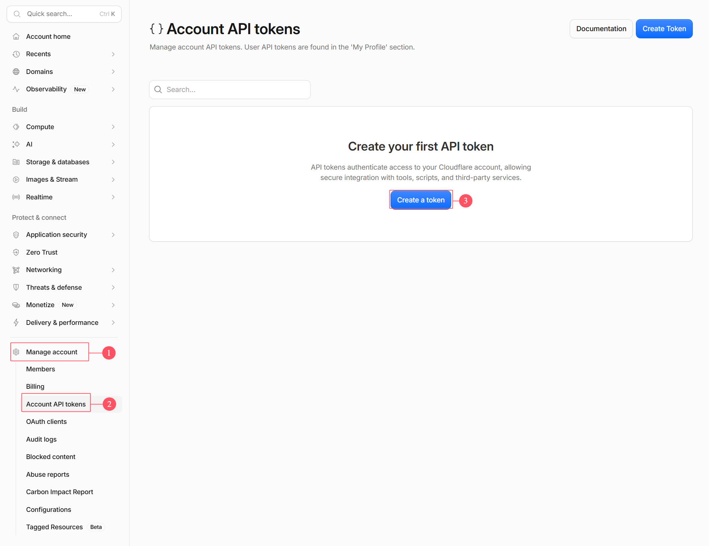
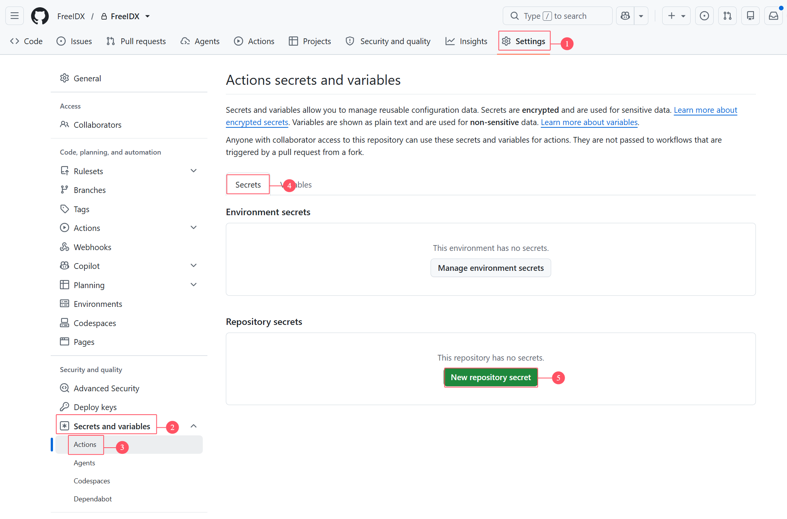

# FreeIDX

[English](../README.md) · [简体中文](README-cn.md) · [繁體中文](README-zh-tw.md) · [日本語](README-ja.md) · [한국어](README-ko.md) · [Français](README-fr.md) · [Deutsch](README-de.md) · **Español** · [Русский](README-ru.md) · [ไทย](README-th.md)

**Un foro moderno, gratuito y de código abierto, construido íntegramente sobre Cloudflare.**

`Cloudflare Workers` · `React 19` · `Tailwind CSS 4` · `Hono` · `TypeScript` · `D1` · `KV` · `R2` · `i18n` · `AGPL-3.0`

[Características](#-características) · [Arquitectura](#️-arquitectura) · [Inicio rápido](#-inicio-rápido) · [Dominio personalizado](#-configuración-de-dominio-personalizado) · [Estructura del repositorio](#-estructura-del-repositorio)

***

Un foro basado en Cloudflare Workers + D1 + KV + R2, con soporte para publicaciones, comentarios, subida de adjuntos, membresías, indexación SEO, multiidioma y más.

**💡 Funciona completamente gratis**: el frontend y el backend se despliegan como un único proyecto Worker, los archivos estáticos se sirven mediante Workers Assets, y D1/KV/R2 se mantienen dentro del nivel gratuito — costo cero, cero operaciones.

***

## 🏗️ Arquitectura

### Despliegue combinado en un solo Worker

```
User visits: forum.example.com
         ↓
   Cloudflare Worker「freeidx-api」(Edge network)
         ↓
  ┌─ Worker route matching
  │
  ├─ /assets/* ?
  │  └─ YES → Workers Assets serves static files directly (no Worker request consumed)
  │
  ├─ /api/* / /files/* ?
  │  ├─ YES → Hono Worker handles business logic
  │  │         ├ JWT + Session dual-track authentication
  │  │         ├ Permission engine (user groups × sections × moderators)
  │  │         └ Returns JSON / streams R2 files via proxy
  │
  └─ Others → Crawler pre-rendered HTML / SPA index.html, handled by React Router
```

### Stack tecnológico

| Capa               | Elección                                                                            |
| ------------------ | ----------------------------------------------------------------------------------- |
| Frontend           | React 19 + React Router 7 + Tailwind CSS 4 + TanStack Query + Zustand + Vite        |
| Backend            | Hono + TypeScript + Zod (Cloudflare Workers)                                        |
| Base de datos      | D1 (SQLite), KV para caché de escrituras poco frecuentes, Cache API para caché en el edge |
| Almacenamiento     | R2 (adjuntos/avatares, servidos en streaming a través del proxy del Worker `/files/:key`) |
| Autenticación      | JWT (httpOnly Cookie) + tabla de sesiones en D1, PBKDF2-SHA256                      |
| CAPTCHA            | Cloudflare Turnstile                                                                |
| Tareas programadas | Cron Triggers (nivel de 5 minutos + nivel de conciliación horaria + nivel diario)   |
| Gestión de paquetes| pnpm workspace + Turborepo (monorepo: `apps/web` / `apps/api` / `packages/shared`)  |

## ✨ Características

### 📝 Núcleo del foro

- ✅ **Gestión de publicaciones** - Publicar, editar, eliminar, fijar, cerrar, mover entre secciones, destacar; paginación por cursores + scroll infinito; actualizaciones optimistas con TanStack Query (el conteo de publicaciones y de vistas se refleja al instante)
- ✅ **Sistema de comentarios** - Respuestas, citas, resaltado de palabras clave, marcadores de lectura, respuestas multinivel
- ✅ **Subida de adjuntos** - Imágenes/archivos se suben directamente a R2 y se sirven en streaming a través del proxy del Worker `/files/:key`, sin tarifas de salida y evitando las cuotas de operaciones de Storage Class B; editor de texto enriquecido **TipTap** integrado, con inserción de código y pegado de imágenes
- ✅ **Búsqueda** - Búsqueda por palabras clave dentro de las secciones, con los fragmentos coincidentes resaltados

### 👥 Usuarios y permisos

- ✅ **Autenticación de usuarios** - Registro, inicio de sesión, cierre de sesión, códigos de verificación por correo, recuperación de contraseña; autenticación de doble vía con JWT (httpOnly Cookie) + tabla de sesiones, protección CSRF en todo el sitio
- ✅ **Sistema de permisos de tres niveles** - Grupos de usuarios × acceso a secciones × motor de reglas de moderadores, con autorización de lectura/escritura y de moderación hasta el nivel de cada sección
- ✅ **Ascenso automático de grupo de usuario** - Cuando el número de publicaciones + temas entra en un rango de créditos, el grupo cambia automáticamente, sin intervención manual
- ✅ **Centro de usuario** - Subida de avatar, edición de perfil, cambio de contraseña, mis temas/respuestas, preferencias de notificaciones por correo
- ✅ **Acciones de moderación** - Fijar/cerrar/eliminar/mover/eliminar usuario, con soporte de procesamiento por lotes

### 💎 Membresía y monetización

- ✅ **Sistema de membresía** - Créditos + niveles + VIP + adjuntos de pago + pagos de pedidos, un circuito cerrado completo
- ✅ **Canales de pago conectables** - card / paypal / stripe / alipay, un plugin independiente por canal; payment-core contiene solo contratos + registro + máquina de estados de pedidos; activa o desactiva cada canal y rota las claves desde el panel de administración sin ningún despliegue
- ✅ **Sistema de anuncios** - Espacios publicitarios personalizados + Google AdSense, con configuración flexible en múltiples ubicaciones

### 🔌 Extensibilidad e ingeniería

- ✅ **Mecanismo de plugins** - Puntos de extensión hook / overwrite + slots de componentes en el frontend, intercambiables en caliente desde el panel de administración, ampliando funcionalidades sin tocar el código central
- ✅ **Panel de administración** - Ajustes del sitio, secciones, temas, usuarios, grupos de usuarios, caché — todo en un solo lugar
- ✅ **Multiidioma** - Chino simplificado/tradicional / inglés / japonés / coreano / francés / alemán / español / ruso / tailandés — 10 idiomas en total, generación por scripts + validación en todo el pipeline de pre-commit, eliminando los textos codificados de forma fija
- ✅ **Tareas programadas** - Planificación en tres niveles con Cron Triggers (cada 5 minutos / conciliación horaria / diaria), automatizando el reciclado de sesiones, el reinicio diario de estadísticas, el GC de adjuntos y la conciliación de pedidos huérfanos

### 🔍 Indexación SEO / GEO

- ✅ **Prerrenderizado para crawlers** - El HTML SEO se pregenera al escribir y se almacena en R2 + Cache API, sirviéndose solo a los user agents de los crawlers; la CPU de renderizado en tiempo de solicitud se reduce estructuralmente a cero
- ✅ **Kit completo de indexación** - sitemap, datos estructurados JSON-LD, llms.txt, políticas para crawlers de IA, robots; URLs pseudoestáticas `.htm` por compatibilidad con versiones anteriores
- ✅ **Caché en el edge** - Barrera de lectura mediante Cache API; los endpoints populares obtienen `x-edge-cache: HIT` en el segundo acceso, ahorrando de forma significativa la cuota de lectura de D1

### 🔐 Seguridad y adaptación al nivel gratuito

- ✅ **Seguridad de contraseñas** - PBKDF2-SHA256 (WebCrypto), con el número de iteraciones ajustado al límite de CPU de 10 ms de los Workers, y actualización diferida por compatibilidad con los hashes heredados
- ✅ **CAPTCHA** - Cloudflare Turnstile integrado, presente en inicio de sesión/registro/publicación/respuestas/recuperación de contraseña
- ✅ **Servicio de correo** - Pool de cuentas SMTP / Email Provider para una entrega fiable de los correos de verificación y de recuperación de contraseña
- ✅ **Adaptación profunda al nivel gratuito** - Caché multicapa (memoria LRU dentro del Isolate + KV + tabla de caché en D1 + Cache API), consultas combinadas con `DB.batch()`, conteo asíncrono combinado con `waitUntil` — exprimiendo al máximo la cuota de 100k solicitudes/día, 5M de lecturas de filas / 100k escrituras de filas

## 🚀 Inicio rápido

## Método 1: Despliegue automatizado con GitHub Actions (recomendado)

El proyecto incluye `.github/workflows/deploy.yml`; hacer push a la rama `main` o activarlo manualmente compila y despliega automáticamente en Cloudflare. D1 / KV son **buscados automáticamente por nombre y creados si faltan** por el pipeline — no es necesario editar manualmente ningún archivo del repositorio.

#### Paso 1: Obtener un Token de API de Cloudflare

1. Inicia sesión en el [Cloudflare Dashboard](https://dash.cloudflare.com/)
2. Ve a **My Profile > API Tokens** y haz clic en **Create Token**

   
3. Haz clic en "View all templates", selecciona la plantilla **Developer Services** en la página de tarjetas de plantillas, deja todo lo demás tal como está y haz clic en **Review Token** para terminar.
4. Copia el Token (solo se muestra una vez) y el Account ID de tu cuenta, y guarda ambos.

#### Paso 2: Configurar los GitHub Secrets

Haz un fork del proyecto en tu propio repositorio. En tu repositorio de GitHub:

1. Ve a **Settings > Secrets and variables > Actions**
2. Añade los siguientes secrets, usando la imagen de abajo para localizar la entrada:

   ① **Settings** → ② **Secrets and variables → Actions** → ③ pestaña **Secrets** → ④ **New repository secret**.

   

| Nombre del secret      | Valor                      | Descripción                                             | Obligatorio |
| ---------------------- | -------------------------- | ------------------------------------------------------- | ----------- |
| `CLOUDFLARE_API_TOKEN` | Token de API de Cloudflare | El Token creado en el Paso 1                            | Sí          |
| `CLOUDFLARE_ACCOUNT_ID`| Tu Account ID de Cloudflare| Barra lateral derecha de la página de inicio de la cuenta | Sí        |

**Variables:**

| Nombre de la variable | Valor                         | Descripción                                                                                                                                                                                                            | Obligatorio |
| --------------------- | ----------------------------- | ---------------------------------------------------------------------------------------------------------------------------------------------------------------------------------------------------------------------- | ----------- |
| `SITE_URL`            | URL del sitio                 | p. ej. `https://forum.example.com` (si todavía no tienes un dominio, **no crees esta variable por ahora**; vuelve tras vincular el dominio; no escribas la palabra "empty")                                             | No          |
| `TURNSTILE_SITEKEY`   | Site Key de Cloudflare Turnstile | [Cloudflare Turnstile](https://dash.cloudflare.com/?to=/:account/turnstile); si no se crea, el widget de verificación no se renderizará en el frontend. Cambiar el valor requiere volver a desplegar el frontend para que surta efecto | No   |

### Paso 3: Primer despliegue

En la página **Actions** de tu repositorio de GitHub:

1. Selecciona el workflow **Deploy to Cloudflare**
2. Haz clic en **Run workflow**, selecciona la rama `main` y marca:
   - `apply_migrations` — crear las tablas (`apps/api/migrations/`)
   - `run_seed` — secciones iniciales + primer administrador
3. Cuando la ejecución termine en verde, tu foro estará en línea; el Worker `freeidx-api` también se crea solo en este paso. **En los push posteriores a main, estas dos casillas están desmarcadas por defecto** y no tocarán la base de datos.

#### Paso 4: Configurar los secrets en tiempo de ejecución

Una vez que el primer despliegue termine en verde, `freeidx-api` aparecerá en la lista de Workers. Entra en él → **Settings → Variables and secrets**, elige el tipo **Secret** y añádelos uno por uno (invisibles una vez guardados, pero los despliegues no los sobrescriben; se rellenan una vez y son válidos de forma permanente):

| Nombre               | Propósito                                                                  | Obligatorio                                       |
| -------------------- | -------------------------------------------------------------------------- | ------------------------------------------------- |
| `JWT_SECRET`         | Firma de tokens de inicio de sesión / CSRF                                 | Sí                                                |
| `TURNSTILE_SECRET`   | Verificación CAPTCHA del lado del servidor (debe ir emparejado con `TURNSTILE_SITEKEY`) | No                                   |
| `SECRETS_MASTER_KEY` | Clave maestra AES-GCM para los secrets de pago de los plugins              | No                                                |

Genera un valor aleatorio localmente y pega uno cada vez:

```bash
node -e "console.log(require('crypto').randomBytes(32).toString('hex'))"
```

### Método 2: Desarrollo local

```bash
pnpm install

# Build the frontend first, then start the backend (wrangler dev reads the same [assets] config)
pnpm --filter @freeidx/web build
pnpm --filter @freeidx/api dev
```

- Ejecuta miniflare en local; no se necesitan IDs de recursos reales
- Guarda los secrets en `apps/api/.dev.vars`
- Base de datos: `pnpm db:apply` para aplicar las migraciones, `pnpm db:seed` para cargar los datos iniciales

## Método 3: Creación visual desde el Cloudflare Dashboard

Workers & Pages → Create → **Continue with GitHub** también funciona, pero requiere rellenar manualmente los IDs reales de D1/KV y `SITE_URL` en `apps/api/wrangler.toml` desde la interfaz web de GitHub (el repositorio contiene valores de marcador de posición; el fallo está garantizado si no se cambian), y el nombre del proyecto debe ser `freeidx-api`. Elige esta opción o el pipeline.

## 🌐 Configuración de dominio personalizado

1. Página de inicio de Cloudflare → **Add a domain**, aloja el dominio allí y cambia los dos registros NS en tu registrador
2. Workers → `freeidx-api` → **Settings → Domains & Routes → Add → Custom domain**
3. Vuelve a las Variables de GitHub y establece `SITE_URL` con este dominio; haz push de cualquier commit para que surta efecto

No es necesaria ninguna configuración de Route — `/api/*`, `/files/*` y las rutas de páginas están todas en el mismo Worker. La caché en el edge surte efecto automáticamente una vez vinculado el dominio personalizado; recuerda también desactivar el dominio de vista previa `*.workers.dev` para evitar que los buscadores lo indexen como contenido duplicado.

**Cuenta de administrador por defecto** (¡cámbiala inmediatamente después del primer inicio de sesión!):

- Correo electrónico: `admin@admin.com` / Contraseña: `1`

## 📦 Estructura del repositorio

```
FreeIDX/
├── apps/
│   ├── web/               # Frontend React 19 SPA → Worker Static Assets
│   └── api/               # Backend Hono Worker (includes migrations/)
├── packages/
│   └── shared/            # Frontend/backend shared types, error codes, i18n resources
├── scripts/               # i18n generation and validation scripts
├── docs/                  # Design docs (dev architecture / frontend-backend page design / deployment manual)
└── .github/workflows/     # CI / deployment pipeline
```

## 📄 Licencia

Este proyecto se publica bajo la [GNU Affero General Public License v3.0 (AGPL-3.0)](../LICENSE).

**Importante:** conforme al artículo 13 de la AGPL-3.0, quien modifique el código de este proyecto y lo ofrezca como servicio en línea (SaaS) **debe** poner el código fuente completo de la versión modificada a disposición de los usuarios de dicho servicio.

## 🙋 Soporte

- 💬 Issues y Pull Requests son bienvenidos
- 🌟 Si te sirve de ayuda, ¡dale una Star a este proyecto!

