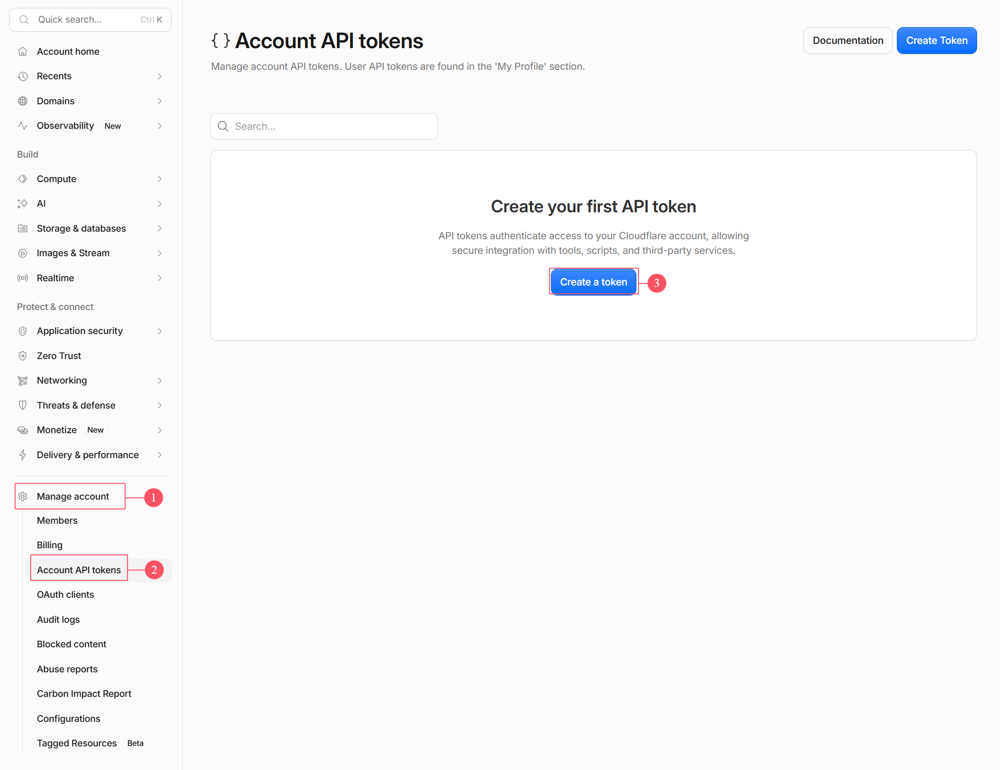
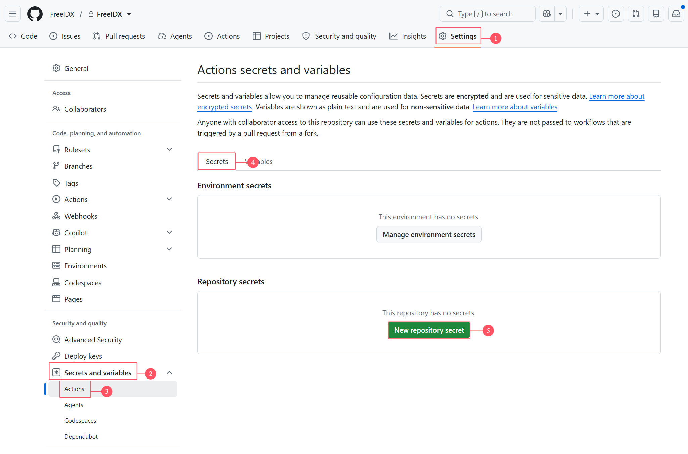

# FreeIDX

[English](../README.md) · [简体中文](README-cn.md) · [繁體中文](README-zh-tw.md) · **日本語** · [한국어](README-ko.md) · [Français](README-fr.md) · [Deutsch](README-de.md) · [Español](README-es.md) · [Русский](README-ru.md) · [ไทย](README-th.md)

**完全に Cloudflare 上で構築された、無料のオープンソース・モダンフォーラム。**

`Cloudflare Workers` · `React 19` · `Tailwind CSS 4` · `Hono` · `TypeScript` · `D1` · `KV` · `R2` · `i18n` · `AGPL-3.0`

[機能](#-機能) · [アーキテクチャ](#️-アーキテクチャ) · [クイックスタート](#-クイックスタート) · [カスタムドメイン](#-カスタムドメインの設定) · [リポジトリ構成](#-リポジトリ構成)

***

Cloudflare Workers + D1 + KV + R2 をベースにしたフォーラムです。投稿、コメント、添付ファイルのアップロード、メンバーシップ、SEO インデックス、多言語対応などの機能を備えています。

**💡 完全無料で運用**：フロントエンドとバックエンドは 1 つの Worker プロジェクトとしてデプロイし、静的アセットは Workers Assets で配信します。D1/KV/R2 はすべて無料枠の範囲内に収まるため、コストも運用負担もゼロです。

***

## 🏗️ アーキテクチャ

### 単一 Worker による統合デプロイ

```
User visits: forum.example.com
         ↓
   Cloudflare Worker「freeidx-api」(Edge network)
         ↓
  ┌─ Worker route matching
  │
  ├─ /assets/* ?
  │  └─ YES → Workers Assets serves static files directly (no Worker request consumed)
  │
  ├─ /api/* / /files/* ?
  │  ├─ YES → Hono Worker handles business logic
  │  │         ├ JWT + Session dual-track authentication
  │  │         ├ Permission engine (user groups × sections × moderators)
  │  │         └ Returns JSON / streams R2 files via proxy
  │
  └─ Others → Crawler pre-rendered HTML / SPA index.html, handled by React Router
```

### 技術スタック

| レイヤー    | 採用技術                                                                              |
| ------- | --------------------------------------------------------------------------------- |
| フロントエンド | React 19 + React Router 7 + Tailwind CSS 4 + TanStack Query + Zustand + Vite      |
| バックエンド  | Hono + TypeScript + Zod（Cloudflare Workers）                                       |
| データベース  | D1（SQLite）。低頻度の書き込みキャッシュには KV、エッジキャッシュには Cache API を使用                            |
| ストレージ   | R2（添付ファイル・アバター。Worker プロキシ `/files/:key` でストリーミング配信）                              |
| 認証      | JWT（httpOnly Cookie）+ D1 セッションテーブル、PBKDF2-SHA256                                  |
| CAPTCHA | Cloudflare Turnstile                                                              |
| 定時タスク   | Cron Triggers（5 分ごと + 毎時突合 + 毎日の 3 段階構成）                                          |
| パッケージ管理 | pnpm workspace + Turborepo（monorepo: `apps/web` / `apps/api` / `packages/shared`） |

## ✨ 機能

### 📝 フォーラムのコア機能

- ✅ **投稿管理** - 公開、編集、削除、ピン留め、クローズ、セクション間の移動、特集設定。カーソルベースのページネーション + 無限スクロール、TanStack Query による楽観的更新（投稿数・閲覧数が即時反映）
- ✅ **コメントシステム** - 返信、引用、キーワードハイライト、既読マーク、多階層の返信
- ✅ **添付ファイルのアップロード** - 画像 / ファイルを R2 に直接アップロードし、Worker プロキシ `/files/:key` でストリーミング配信。下り（エグレス）料金ゼロの恩恵を受けつつ、Storage Class B の操作クォータも回避。**TipTap リッチテキストエディタ**を内蔵し、コード挿入や画像の貼り付けアップロードに対応
- ✅ **検索** - セクション内のキーワード検索。マッチした部分をハイライト表示

### 👥 ユーザーと権限

- ✅ **ユーザー認証** - 登録、ログイン、ログアウト、メール認証コード、パスワード再設定。JWT（httpOnly Cookie）+ セッションテーブルの二重認証、サイト全体の CSRF 保護
- ✅ **3 層権限システム** - ユーザーグループ × セクションアクセス × モデレーターのルールエンジン。個々のセクション単位まで読み書き・モデレーションの権限を設定可能
- ✅ **ユーザーグループの自動昇格** - 投稿数 + トピック数がクレジット区間に入ると自動的にグループが切り替わり、手動操作は不要
- ✅ **ユーザーセンター** - アバターのアップロード、プロフィール編集、パスワード変更、自分のトピック / 返信、メール通知の設定
- ✅ **モデレーション操作** - ピン留め / クローズ / 削除 / 移動 / ユーザー削除。一括処理に対応

### 💎 メンバーシップとマネタイズ

- ✅ **メンバーシップシステム** - クレジット + レベル + VIP + 有料添付ファイル + 注文決済までを一気通貫でつないだ、完結したクローズドループ
- ✅ **プラグイン式の決済チャネル** - card / paypal / stripe / alipay に対応し、チャネルごとに独立したプラグインを用意。payment-core はコントラクト + レジストリ + 注文のステートマシンのみを含み、管理パネルから各チャネルの有効化 / 無効化やキーのローテーションが可能。デプロイは一切不要
- ✅ **広告システム** - カスタム広告スロット + Google AdSense。複数の掲載位置を柔軟に設定可能

### 🔌 拡張性とエンジニアリング

- ✅ **プラグイン機構** - hook / overwrite の拡張ポイント + フロントエンドのコンポーネントスロット。管理パネルからホットスワップでき、コアコードに手を加えずに機能を拡張
- ✅ **MCP サーバー** - フォーラムの内容を MCP 経由で AI クライアント（Claude Desktop / Cursor など）に提供。個人アクセストークンは権限・審査状態・ペイウォールの三重制約下にあり、書き込み系ツールは既定で無効
- ✅ **管理パネル** - サイト設定、セクション、トピック、ユーザー、ユーザーグループ、キャッシュを 1 か所で管理
- ✅ **多言語対応** - 簡体字中国語 / 繁体字中国語 / 英語 / 日本語 / 韓国語 / フランス語 / ドイツ語 / スペイン語 / ロシア語 / タイ語の合計 10 言語。スクリプト生成 + pre-commit での全工程チェックにより、ハードコードされた文言を排除
- ✅ **定時タスク** - Cron Triggers による 3 段階のスケジューリング（5 分ごと / 毎時突合 / 毎日）。セッションの回収、日次統計のリセット、添付ファイルの GC、孤立注文の突合を自動化

### 🔍 SEO / GEO インデックス対応

- ✅ **クローラー向け事前レンダリング** - SEO 用 HTML を書き込み時に事前生成して R2 + Cache API に保存し、クローラーの User-Agent にのみ配信。リクエスト時のレンダリング CPU を構造的にゼロに
- ✅ **インデックス登録のフルセット** - sitemap、JSON-LD 構造化データ、llms.txt、AI クローラーポリシー、robots。後方互換のための疑似静的 `.htm` URL にも対応
- ✅ **エッジキャッシュ** - Cache API による読み取りバリア。人気のエンドポイントは 2 回目のアクセスで `x-edge-cache: HIT` となり、D1 の読み取りクォータを大幅に節約

### 🔐 セキュリティと無料枠への適合

- ✅ **パスワードセキュリティ** - PBKDF2-SHA256（WebCrypto）。Workers の 10ms CPU 制限に合わせて反復回数を調整し、旧ハッシュとの互換性のための遅延アップグレードにも対応
- ✅ **CAPTCHA** - Cloudflare Turnstile を統合し、ログイン / 登録 / 投稿 / 返信 / パスワード再設定に設置
- ✅ **メールサービス** - SMTP / Email Provider のアカウントプールで、認証メールやパスワード再設定メールを確実に配信
- ✅ **無料枠への徹底適合** - 多層キャッシュ（Isolate 内 LRU メモリ + KV + D1 キャッシュテーブル + Cache API）、`DB.batch()` によるマージクエリ、`waitUntil` による非同期マージ集計 —— 1 日 10 万リクエスト、行読み取り 500 万行 / 行書き込み 10 万行のクォータを最大限に活用します

## 🚀 クイックスタート

## 方法 1: GitHub Actions による自動デプロイ（推奨）

プロジェクトには `.github/workflows/deploy.yml` が同梱されており、`main` ブランチへのプッシュや手動トリガーで、Cloudflare へのビルドとデプロイが自動的に行われます。D1 / KV はパイプラインが**名前で自動検索し、存在しない場合は自動作成**するため、リポジトリ内のファイルを手動で編集する必要はありません。

#### ステップ 1: Cloudflare API Token の取得

1. [Cloudflare Dashboard](https://dash.cloudflare.com/) にログインします
2. **My Profile > API Tokens** を開き、**Create Token** をクリックします

   
3. 「View all templates」をクリックし、テンプレートカードの画面で **Developer Services** テンプレートを選択します。そのほかの設定はすべてそのままにして、**Review Token** をクリックすれば完了です。
4. Token（一度しか表示されません）と、アカウントの Account ID をコピーして、両方を控えておきます。

#### ステップ 2: GitHub Secrets の設定

プロジェクトを自分のリポジトリにフォークします。GitHub リポジトリで以下を行います：

1. **Settings > Secrets and variables > Actions** に移動します
2. 以下の secrets を追加します。設定画面への入り口は下の画像を参照してください：

   ① **Settings** → ② **Secrets and variables → Actions** → ③ **Secrets** タブ → ④ **New repository secret**。

   

| Secret 名                | 値                         | 説明                 | 必須 |
| ----------------------- | ------------------------- | ------------------ | -- |
| `CLOUDFLARE_API_TOKEN`  | Cloudflare API Token      | ステップ 1 で作成した Token | はい |
| `CLOUDFLARE_ACCOUNT_ID` | 自分の Cloudflare Account ID | アカウントホーム画面の右サイドバー  | はい |

> この表は Cloudflare API Token / Account ID 専用です。`JWT_SECRET` や `SECRETS_MASTER_KEY` などの**ランタイムシークレットはここでは設定できません**（デプロイパイプラインは Worker に転送しません）。ステップ 4 で Worker 側に追加してください。

**変数：**

| 変数名                 | 値                               | 説明                                                                                                                                            | 必須  |
| ------------------- | ------------------------------- | --------------------------------------------------------------------------------------------------------------------------------------------- | --- |
| `SITE_URL`          | サイトの URL                        | 例: `https://forum.example.com`（まだドメインをお持ちでない場合は、**この変数は今は作成しないでください**。ドメインを紐付けた後に改めて設定してください。なお「空」という語は入力しないでください）                            | いいえ |
| `TURNSTILE_SITEKEY` | Cloudflare Turnstile の Site Key | [Cloudflare Turnstile](https://dash.cloudflare.com/?to=/:account/turnstile)。作成しないとフロントエンドに認証ウィジェットが表示されません。値を変更した場合は、フロントエンドを再デプロイしないと反映されません | いいえ |

### ステップ 3: 初回デプロイ

GitHub リポジトリの **Actions** ページで以下を行います：

1. **Deploy to Cloudflare** ワークフローを選択します
2. **Run workflow** をクリックし、`main` ブランチを選択して `run_seed` にチェックを入れます — 初期セクションと最初の管理者を作成します（テーブルは `apps/api/migrations/` から自動的に作成され、チェックは不要です）。
3. グリーンで完了すれば公開は完了です。Worker `freeidx-api` もこのステップで初めて作成されます。**以降の main へのプッシュでは `run_seed` はデフォルトでオフ**です。マイグレーションは自動的に適用され、既存データには影響しません。

#### ステップ 4: ランタイム Secrets の設定

初回デプロイがグリーンで完了すると、Workers のリストに `freeidx-api` が表示されます。クリックして開き、**Settings → Variables and secrets** でタイプを **Secret** に選択して、1 つずつ追加してください（保存後は値が表示されなくなりますが、デプロイで上書きされることはなく、一度入力すれば長期的に有効です）：

| 名前                   | 用途                                                        | 必須                     |
| -------------------- | --------------------------------------------------------- | ---------------------- |
| `JWT_SECRET`         | ログイントークン / CSRF の署名                                       | はい                     |
| `TURNSTILE_SECRET`   | サーバーサイドでの CAPTCHA 検証（`TURNSTILE_SITEKEY` とペアで設定する必要があります） | いいえ                    |
| `SECRETS_MASTER_KEY` | プラグイン決済シークレット / メール SMTP パスワードの AES-GCM マスターキー | いいえ（未設定だとメールパスワードを保存できません） |

ローカルでランダムな値を生成し、1 つずつ貼り付けてください：

```bash
# JWT_SECRET: any strong random string
node -e "console.log(require('crypto').randomBytes(32).toString('hex'))"
# SECRETS_MASTER_KEY: base64 of exactly 32 bytes (44 chars) or 64-char hex
node -e "console.log(require('crypto').randomBytes(32).toString('base64'))"
```

> `SECRETS_MASTER_KEY` が未設定の場合、管理画面の「メール設定」で**パスワード付き**の SMTP アカウントを保存すると「SECRETS_MASTER_KEY未設定のためパスワードを保存できません」で失敗します。値は **base64 の 32 バイト（44 文字）または 64 桁の hex** のいずれでも構いませんが、それ以外（コマンド文字列・引用符付き・短い文字列）は「SECRETS_MASTER_KEY は base64 エンコードされた 32 バイトの鍵である必要があります」で失敗します。一度パスワードの暗号化に使った値は**変更しないでください**：既存の暗号文は復号できなくなり（保存済みパスワードが無効化され、送信は 535）、すべてのパスワードを再入力する必要があります。Node がない環境ではブラウザの F12 → Console で生成できます：`btoa(String.fromCharCode(...crypto.getRandomValues(new Uint8Array(32))))`。

### 方法 2: ローカル開発

```bash
pnpm install

# Build the frontend first, then start the backend (wrangler dev reads the same [assets] config)
pnpm --filter @freeidx/web build
pnpm --filter @freeidx/api dev
```

- ローカルでは miniflare で動作し、実際のリソース ID は不要です
- secrets は `apps/api/.dev.vars` に記述します（`JWT_SECRET`、`SECRETS_MASTER_KEY` など）。`wrangler dev` は起動時に一度だけ読み込むため、編集後は再起動が必要です
- データベース: `pnpm db:apply` でマイグレーションを適用、`pnpm db:seed` で初期データを読み込みます

## 方法 3: Cloudflare Dashboard での画面操作による構築

Workers & Pages → Create → **Continue with GitHub** でも構築できますが、その場合は GitHub の Web UI 上で、実際の D1/KV の ID と `SITE_URL` を `apps/api/wrangler.toml` に手動で書き込む必要があります（リポジトリにはプレースホルダーの値が入っており、変更しなければ確実に失敗します）。また、プロジェクト名は `freeidx-api` である必要があります。こちらとパイプラインのどちらか一方を選択してください。

## 🌐 カスタムドメインの設定

1. Cloudflare のホームページ → **Add a domain** でドメインを追加して Cloudflare 上でホストし、レジストラ側で 2 つの NS レコードを変更します
2. Workers → `freeidx-api` → **Settings → Domains & Routes → Add → Custom domain**
3. GitHub の Variables に戻り、`SITE_URL` にこのドメインを設定します。任意のコミットをプッシュすると反映されます

Route の設定は不要です。`/api/*`、`/files/*`、ページのパスはすべて同じ Worker の中にあります。カスタムドメインを紐付けるとエッジキャッシュは自動的に有効になります。また、検索エンジンに重複コンテンツとしてインデックスされるのを避けるため、`*.workers.dev` のプレビュードメインを無効化しておくことも忘れないでください。

**デフォルトの管理者アカウント**（初回ログイン後、必ずすぐに変更してください！）：

- メールアドレス: `admin@admin.com` / パスワード: `1`

## 📦 リポジトリ構成

```
FreeIDX/
├── apps/
│   ├── web/               # Frontend React 19 SPA → Worker Static Assets
│   └── api/               # Backend Hono Worker (includes migrations/)
├── packages/
│   └── shared/            # Frontend/backend shared types, error codes, i18n resources
├── scripts/               # i18n generation and validation scripts
├── docs/                  # Design docs (dev architecture / frontend-backend page design / deployment manual)
└── .github/workflows/     # CI / deployment pipeline
```

## 📄 ライセンス

本プロジェクトは [GNU Affero General Public License v3.0（AGPL-3.0）](../LICENSE) の下で公開されています。

**重要：** AGPL-3.0 第 13 条に基づき、本プロジェクトのコードを改変し、ネットワーク経由でサービス（SaaS）として提供する場合は、そのサービスの利用者に対して**改変後の完全なソースコードを公開しなければなりません**。

## 🙋 サポート

- 💬 Issues や Pull Request を歓迎します
- 🌟 このプロジェクトが役に立ったら、ぜひ Star をお願いします！

